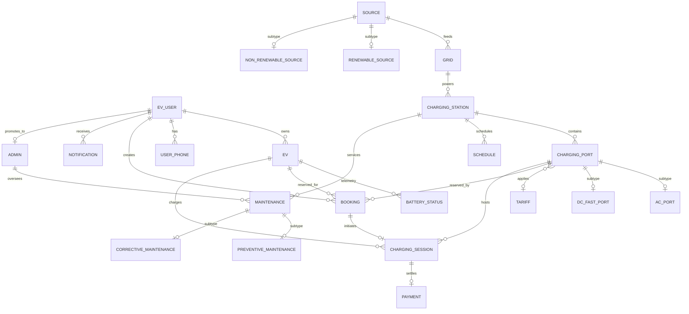

# Smart EV Charging Station Management System — MongoDB Database Design

**Database Name:** `smart_ev_charging`  
**Driver / ODM:** Async Motor (PyMongo) with Pydantic v2 validation  
**Timestamp Standard:** ISO 8601 UTC  
**Identifier Standard:** Native BSON `ObjectId` for `_id`, returned as hex string in API responses. Inter-entity references store ObjectId/hex string foreign keys. Backward and forward compatibility for original integer IDs (`user_id`, `station_id`, `port_id`, etc.) is fully maintained.

---

## 1. System Entity Architecture & ER Diagram

The system models **22 distinct domain entities** organized across infrastructure, user management, energy grid supply, hardware subtypes, charging reservations, billing, and maintenance operations.

---

## 2. All 22 Collections & Field Specifications

### 1. `users` (Entity 1: EV_USER)
Stores EV drivers and registered system users.
- `_id` (`ObjectId`, Required, PK): Unique document identifier.
- `user_id` (`Int` / `String`, Optional): Legacy integer/identifier reference.
- `first_name` (`String`, Optional): User's first name.
- `last_name` (`String`, Optional): User's last name.
- `full_name` (`String`, Required): Full legal name.
- `email` (`String`, Required, Unique): User's unique email address (login credential).
- `password_hash` (`String`, Required): Argon2 / bcrypt password hash.
- `phone` (`String`, Optional): Primary contact telephone.
- `address` (`String`, Optional): Physical billing/residence address.
- `role` (`String`, Required, Enum: `["customer", "admin", "operator"]`): Authorization tier.
- `status` (`String`, Required, Enum: `["active", "suspended", "deleted"]`): Account lifecycle state.
- `created_at` (`Date` / UTC string, Required): Document creation timestamp.
- `updated_at` (`Date` / UTC string, Optional): Last profile modification timestamp.

**Indexes:**
- `email_1`: Unique index on `email`.
- `role_1`: Single-field index on `role`.
- `status_1`: Single-field index on `status`.
- `user_id_1`: Sparse index on legacy `user_id`.

---

### 2. `admins` (Entity 2: ADMIN)
Represents elevated administrators responsible for station operations, tariff modifications, and maintenance assignments.
- `_id` (`ObjectId`, Required, PK): Document identifier.
- `admin_id` (`Int` / `String`, Optional): Legacy admin identifier.
- `user_id` (`String` / `ObjectId`, Required): Foreign key referencing `users._id`.
- `first_name` (`String`, Optional): Administrator first name.
- `last_name` (`String`, Optional): Administrator last name.
- `full_name` (`String`, Required): Administrator full name.
- `email` (`String`, Required, Unique): Corporate administrative email.
- `role` (`String`, Required): Functional role (e.g., `SuperAdmin`, `OperationsManager`, `MaintenanceLead`).
- `privileges` (`Array<String>`, Optional): Fine-grained capability tokens.
- `contact_no` / `phone` (`String`, Optional): Administrative contact number.
- `hire_date` (`Date` / UTC string, Optional): Employment date.
- `experience_years` (`Int`, Optional): Domain experience in years.
- `created_at` (`Date` / UTC string, Required): Creation timestamp.

**Indexes:**
- `email_1`: Unique index on `email`.
- `user_id_1`: Sparse index on `user_id`.
- `admin_id_1`: Sparse index on `admin_id`.

---

### 3. `tariffs` (Entity 3: TARIFF)
Pricing schemes applied to charging sessions.
- `_id` (`ObjectId`, Required, PK): Document identifier.
- `tariff_id` (`Int` / `String`, Optional): Legacy tariff identifier.
- `tariff_name` / `name` (`String`, Required, Unique): Unique human-readable tariff title.
- `rate_per_kwh` / `price_per_kwh` (`Double`, Required): Base billing unit cost in INR (> 0).
- `peak_rate` (`Double`, Optional): Surcharge rate during peak demand hours.
- `off_peak_rate` (`Double`, Optional): Discounted rate during off-peak windows.
- `valid_from` (`Date` / UTC string, Optional): Effective start date.
- `valid_to` (`Date` / UTC string, Optional): Expiration date.
- `is_active` (`Boolean`, Required): Active status flag.
- `description` (`String`, Optional): Descriptive conditions of the rate.
- `created_at` (`Date` / UTC string, Required): Creation timestamp.

**Indexes:**
- `name_1`: Unique index on `tariff_name` / `name`.
- `is_active_1`: Filter index for active rate lookups.
- `tariff_id_1`: Sparse index on legacy `tariff_id`.

---

### 4. `sources` (Entity 4: SOURCE)
Energy generation sources feeding local grids and charging hubs. Parent entity in the energy source subtype hierarchy.
- `_id` (`ObjectId`, Required, PK): Document identifier.
- `source_id` (`Int` / `String`, Optional): Legacy source identifier.
- `source_name` / `name` (`String`, Required, Unique): Energy source label.
- `source_type` (`String`, Required, Enum: `["solar", "wind", "hydro", "thermal", "grid_import", "biomass", "nuclear"]`): Primary energy generation type.
- `capacity` / `capacity_kw` (`Double`, Required): Maximum production capacity in kW.
- `unit` (`String`, Optional): Measurement unit (defaults to `kW`).
- `energy_generated_kwh` (`Double`, Optional): Cumulative generated energy in kWh.
- `status` (`String`, Required, Enum: `["active", "maintenance", "offline"]`): Source health status.
- `location` (`String`, Optional): Geographical location of generation plant.
- `created_at` (`Date` / UTC string, Required): Creation timestamp.

**Indexes:**
- `name_1`: Unique index on `source_name` / `name`.
- `source_type_1`: Index for filtering by generation type.
- `status_1`: Index for filtering active generation.
- `source_id_1`: Sparse index on legacy `source_id`.

---

### 5. `charging_stations` (Entity 5: CHARGING_STATION)
Physical charging sites housing ports, transformers, and grid connections.
- `_id` (`ObjectId`, Required, PK): Document identifier.
- `station_id` (`Int` / `String`, Optional): Legacy station identifier.
- `station_name` / `name` (`String`, Required): Station human-readable name.
- `station_code` (`String`, Required, Unique): Unique short code (e.g., `ST-001`).
- `address` (`String`, Required): Street address.
- `city` (`String`, Required): Metropolitan location / municipality.
- `latitude` (`Double`, Required): Geospatial latitude coordinate.
- `longitude` (`Double`, Required): Geospatial longitude coordinate.
- `grid_id` (`String` / `ObjectId`, Optional): Reference to supplying `grids._id`.
- `total_ports` (`Int`, Optional): Number of physical dispensers.
- `status` (`String`, Required, Enum: `["operational", "maintenance", "offline"]`): Operational status.
- `created_at` (`Date` / UTC string, Required): Record creation timestamp.

**Indexes:**
- `station_code_1`: Unique index on station code.
- `status_1`: Operational status filter.
- `city_1`: Geographic search index.
- `station_id_1`: Sparse index on legacy `station_id`.

---

### 6. `evs` (Entity 6: EV)
Electric vehicles registered to drivers.
- `_id` (`ObjectId`, Required, PK): Document identifier.
- `ev_id` (`Int` / `String`, Optional): Legacy EV identifier.
- `user_id` / `owner_id` (`String` / `ObjectId`, Required): Owner reference (`users._id`).
- `registration_number` (`String`, Required, Unique): State license plate / VIN.
- `manufacturer` / `make` (`String`, Optional): Vehicle brand (e.g., Tata, Tesla).
- `model` (`String`, Required): Vehicle model.
- `battery_capacity` / `battery_capacity_kwh` (`Double`, Required): Battery pack rating in kWh (> 0).
- `connector_type` (`String`, Required, Enum: `["CCS2", "CHAdeMO", "Type2", "GB/T"]`): Port compatibility.
- `manufacture_year` (`Int`, Optional): Production year.
- `is_active` / `status` (`Boolean` / `String`, Optional): Active vehicle status.
- `created_at` (`Date` / UTC string, Required): Registration timestamp.

**Indexes:**
- `registration_number_1`: Unique index on vehicle registration.
- `user_id_1`: Fast lookup for all vehicles owned by a driver.
- `ev_id_1`: Sparse index on legacy `ev_id`.

---

### 7. `user_phones` (Entity 7: USER_PHONE)
Multi-phone number directory for users, preserving composite uniqueness `(user_id, phone_number)`.
- `_id` (`ObjectId`, Required, PK): Document identifier.
- `user_id` (`String` / `ObjectId`, Required): References `users._id`.
- `phone_number` / `number` (`String`, Required): E.164 formatted telephone number.
- `phone_type` / `label` (`String`, Optional): E.g., `mobile`, `work`, `emergency`.
- `is_primary` (`Boolean`, Optional): Primary contact boolean indicator.
- `created_at` (`Date` / UTC string, Required): Creation timestamp.

**Indexes:**
- `user_id_1_phone_number_1`: Compound unique index preventing duplicate numbers for the same user.
- `user_id_1`: Index for listing user phone numbers.

---

### 8. `grids` (Entity 8: GRID)
Electrical distribution substations delivering power to charging stations.
- `_id` (`ObjectId`, Required, PK): Document identifier.
- `grid_id` (`Int` / `String`, Optional): Legacy grid identifier.
- `grid_name` / `name` (`String`, Required, Unique): Regional grid name.
- `capacity` / `capacity_kw` (`Double`, Required): Total substation capacity in kW (> 0).
- `current_load` / `current_load_kw` (`Double`, Required): Real-time load consumption in kW.
- `location` (`String`, Optional): Geographic district.
- `source_id` (`String` / `ObjectId`, Optional): Primary generation source reference (`sources._id`).
- `status` (`String`, Required, Enum: `["active", "overloaded", "maintenance", "offline"]`): Grid operational status.
- `created_at` (`Date` / UTC string, Required): Timestamp.

**Indexes:**
- `name_1`: Unique index on `grid_name` / `name`.
- `status_1`: Grid operational filter.
- `grid_id_1`: Sparse index on legacy `grid_id`.

---

### 9. `charging_ports` (Entity 9: CHARGING_PORT)
Individual dispensing guns/connectors at a charging station. Parent entity in the port subtype hierarchy.
- `_id` (`ObjectId`, Required, PK): Document identifier.
- `port_id` (`Int` / `String`, Optional): Legacy port identifier.
- `station_id` (`String` / `ObjectId`, Required): Parent station reference (`charging_stations._id`).
- `station_code` (`String`, Optional): Station short code (denormalized for display).
- `port_number` (`Int`, Required): Port position number (1, 2, ... N).
- `tariff_id` (`String` / `ObjectId`, Optional): Linked pricing tariff (`tariffs._id`).
- `connector_type` (`String`, Required, Enum: `["CCS2", "CHAdeMO", "Type2", "GB/T"]`): Hardware interface.
- `rated_power_kw` (`Double`, Required): Power output capability in kW (> 0).
- `status` (`String`, Required, Enum: `["operational", "maintenance", "offline"]`): Dispenser health.
- `created_at` (`Date` / UTC string, Required): Registration timestamp.

**Indexes:**
- `station_id_1_port_number_1`: Compound unique index enforcing unique port numbering per station.
- `station_id_1`: Foreign key index to list ports by station.
- `status_1`: Filter for available ports.
- `port_id_1`: Sparse index on legacy `port_id`.

---

### 10. `ac_ports` (Entity 10: AC_PORT)
Subtype of `CHARGING_PORT` for Alternating Current (Level 2 / slow) chargers.
- `_id` (`ObjectId`, Required, PK): Subtype document identifier.
- `port_id` (`String` / `ObjectId`, Required): Foreign key to parent `charging_ports._id`.
- `station_id` (`String` / `ObjectId`, Required): Station reference.
- `port_number` (`Int`, Required): Port sequence number matching parent.
- `ac_power_kw` (`Double`, Required): AC continuous output power in kW.
- `phase_type` (`String`, Optional, Enum: `["single_phase", "three_phase"]`): Grid wiring configuration.
- `voltage` (`Double`, Optional): Operating RMS voltage (typically 230V or 415V).
- `max_current_a` (`Double`, Optional): Maximum allowable amperage (e.g., 16A, 32A).
- `created_at` (`Date` / UTC string, Required): Record creation timestamp.

**Indexes:**
- `port_id_1`: Unique index ensuring one-to-one subtype relationship with parent port.
- `station_id_1_port_number_1`: Compound unique index matching parent composite key.

---

### 11. `dc_fast_ports` (Entity 11: DC_FAST_PORT)
Subtype of `CHARGING_PORT` for Direct Current Fast Charging (DCFC / Level 3) dispensers.
- `_id` (`ObjectId`, Required, PK): Subtype document identifier.
- `port_id` (`String` / `ObjectId`, Required): Foreign key to parent `charging_ports._id`.
- `station_id` (`String` / `ObjectId`, Required): Station reference.
- `port_number` (`Int`, Required): Port sequence number matching parent.
- `dc_power_kw` (`Double`, Required): DC peak output power in kW (e.g., 50kW, 150kW, 350kW).
- `max_voltage` (`Double`, Optional): Maximum DC bus voltage (e.g., 500V, 800V, 1000V).
- `max_current_a` (`Double`, Optional): Peak charging current rating (e.g., 125A, 250A, 500A).
- `cooling_type` (`String`, Optional, Enum: `["air", "liquid"]`): Cable and converter thermal management.
- `protocol` (`String`, Optional, Enum: `["CCS", "CHAdeMO", "GB/T"]`): Communication protocol standard.
- `created_at` (`Date` / UTC string, Required): Record creation timestamp.

**Indexes:**
- `port_id_1`: Unique index ensuring one-to-one subtype relationship with parent port.
- `station_id_1_port_number_1`: Compound unique index matching parent composite key.

---

### 12. `bookings` (Entity 12: BOOKING)
Charging slot reservations made by EV drivers.
- `_id` (`ObjectId`, Required, PK): Document identifier.
- `booking_id` (`Int` / `String`, Optional): Legacy booking identifier.
- `user_id` (`String` / `ObjectId`, Required): Reserving driver (`users._id`).
- `ev_id` (`String` / `ObjectId`, Required): Reserved vehicle (`evs._id`).
- `station_id` (`String` / `ObjectId`, Required): Destination station (`charging_stations._id`).
- `port_id` (`String` / `ObjectId`, Required): Specific reserved port (`charging_ports._id`).
- `booking_date` (`Date` / UTC string, Optional): Calendar booking date.
- `start_time` (`Date` / UTC string, Required): Reservation start timestamp.
- `end_time` (`Date` / UTC string, Required): Reservation end timestamp (`end_time > start_time`).
- `status` (`String`, Required, Enum: `["pending", "confirmed", "active", "completed", "cancelled", "no_show"]`): Lifecycle state.
- `created_at` (`Date` / UTC string, Required): Booking placement timestamp.
- `updated_at` (`Date` / UTC string, Optional): Status change timestamp.

**Indexes:**
- `port_id_1_start_time_1_end_time_1`: Compound index for rapid conflict/overlap detection.
- `user_id_1`: Driver reservation history.
- `station_id_1`: Station utilization index.
- `status_1`: Booking state filter.
- `booking_id_1`: Sparse index on legacy `booking_id`.

---

### 13. `charging_sessions` (Entity 13: CHARGING_SESSION)
Physical dispensing sessions delivering electrical energy to connected vehicles.
- `_id` (`ObjectId`, Required, PK): Document identifier.
- `session_id` (`Int` / `String`, Optional): Legacy session identifier.
- `booking_id` (`String` / `ObjectId`, Optional): Linked reservation (`bookings._id`).
- `user_id` (`String` / `ObjectId`, Required): Driver receiving charge (`users._id`).
- `ev_id` (`String` / `ObjectId`, Required): Connected vehicle (`evs._id`).
- `port_id` (`String` / `ObjectId`, Required): Dispensing port (`charging_ports._id`).
- `start_time` / `started_at` (`Date` / UTC string, Required): Session start timestamp.
- `end_time` / `ended_at` (`Date` / UTC string, Optional): Session completion timestamp.
- `energy_consumed_kwh` / `energy_delivered_kwh` (`Double`, Required): Measured metered electrical energy in kWh (>= 0).
- `tariff_price_per_kwh` (`Double`, Optional): Snapshot rate applied at initiation.
- `total_amount` (`Double`, Required): Calculated billed charge in INR (`energy_kwh × rate`).
- `session_status` / `status` (`String`, Required, Enum: `["active", "completed", "stopped"]`): Execution status.
- `created_at` (`Date` / UTC string, Required): Record creation timestamp.
- `updated_at` (`Date` / UTC string, Optional): Record update timestamp.

**Indexes:**
- `booking_id_1`: Sparse unique index linking at most one session per booking.
- `user_id_1`: Driver charging history.
- `port_id_1`: Dispenser duty cycle tracking.
- `status_1`: Active session lookup.
- `session_id_1`: Sparse index on legacy `session_id`.

---

### 14. `payments` (Entity 14: PAYMENT)
Monetary transactions settling charging sessions.
- `_id` (`ObjectId`, Required, PK): Document identifier.
- `payment_id` (`Int` / `String`, Optional): Legacy payment identifier.
- `session_id` (`String` / `ObjectId`, Required): Settled session (`charging_sessions._id`).
- `user_id` (`String` / `ObjectId`, Required): Paying driver (`users._id`).
- `amount` (`Double`, Required): Monetary amount in INR (> 0).
- `payment_date` (`Date` / UTC string, Required): Transaction timestamp.
- `payment_method` (`String`, Required, Enum: `["UPI", "CreditCard", "DebitCard", "Wallet", "RFID_Card"]`): Gateway payment channel.
- `transaction_reference` (`String`, Required, Unique): Cryptographic payment gateway transaction code (e.g., `TXN-...`).
- `payment_status` / `status` (`String`, Required, Enum: `["pending", "completed", "failed", "refunded"]`): Settlement state.
- `created_at` (`Date` / UTC string, Required): Timestamp.

**Indexes:**
- `transaction_reference_1`: Unique index preventing double-billing / replay attacks.
- `session_id_1`: Sparse unique index ensuring one successful payment settlement per session.
- `user_id_1`: Billing history per driver.
- `status_1`: Payment audit reconciliation index.
- `payment_id_1`: Sparse index on legacy `payment_id`.

---

### 15. `schedules` (Entity 15: SCHEDULE)
Station and port operational schedules, blackout maintenance windows, and operating hours.
- `_id` (`ObjectId`, Required, PK): Document identifier.
- `schedule_id` (`Int` / `String`, Optional): Legacy schedule identifier.
- `station_id` (`String` / `ObjectId`, Required): Subject station (`charging_stations._id`).
- `port_id` (`String` / `ObjectId`, Optional): Optional specific port target (`charging_ports._id`).
- `day_of_week` (`String`, Optional): Day label (e.g., `Monday` - `Sunday`, or `All`).
- `start_time` (`Date` / UTC string, Required): Window opening time.
- `end_time` (`Date` / UTC string, Required): Window closing time.
- `schedule_type` (`String`, Optional, Enum: `["operating_hours", "maintenance", "peak_pricing", "restricted"]`): Purpose.
- `is_available` / `status` (`Boolean` / `String`, Required): Availability flag.
- `description` / `note` (`String`, Optional): Schedule details.
- `created_at` (`Date` / UTC string, Required): Timestamp.

**Indexes:**
- `station_id_1_start_time_1`: Schedule lookup by station.
- `port_id_1_start_time_1`: Schedule lookup by port.
- `schedule_id_1`: Sparse index on legacy `schedule_id`.

---

### 16. `maintenance` (Entity 16: MAINTENANCE)
Work orders and service logs conducted on charging equipment. Parent entity in the maintenance subtype hierarchy.
- `_id` (`ObjectId`, Required, PK): Document identifier.
- `maintenance_id` (`Int` / `String`, Optional): Legacy maintenance identifier.
- `station_id` (`String` / `ObjectId`, Required): Target station (`charging_stations._id`).
- `port_id` (`String` / `ObjectId`, Optional): Target port (`charging_ports._id`), if isolated to a single dispenser.
- `admin_id` (`String` / `ObjectId`, Optional): Assigned overseer / engineer (`admins._id` or `users._id`).
- `maintenance_type` (`String`, Required, Enum: `["preventive", "corrective", "inspection", "upgrade"]`): Classification.
- `description` / `title` (`String`, Required): Summary of work performed or scheduled.
- `scheduled_date` (`Date` / UTC string, Required): Scheduled service date.
- `completion_date` (`Date` / UTC string, Optional): Actual resolution date.
- `status` (`String`, Required, Enum: `["scheduled", "in_progress", "completed", "cancelled"]`): Work order progress.
- `cost` (`Double`, Optional): Incurred labor and replacement component cost in INR.
- `created_at` (`Date` / UTC string, Required): Creation timestamp.

**Indexes:**
- `station_id_1`: Maintenance records per station.
- `admin_id_1`: Work orders assigned to an administrator.
- `status_1`: Active maintenance order tracking.
- `maintenance_id_1`: Sparse index on legacy `maintenance_id`.

---

### 17. `notifications` (Entity 17: NOTIFICATION)
In-app and system dispatch alerts for drivers and administrative operators.
- `_id` (`ObjectId`, Required, PK): Document identifier.
- `notification_id` (`Int` / `String`, Optional): Legacy notification identifier.
- `user_id` (`String` / `ObjectId`, Required): Target recipient (`users._id`).
- `message` (`String`, Required): Notification text payload.
- `notification_type` / `type` (`String`, Optional, Enum: `["booking", "session", "payment", "maintenance", "system"]`): Categorization.
- `read_status` / `is_read` (`Boolean`, Required): Read/unread state flag (defaults to `False`).
- `created_at` (`Date` / UTC string, Required): Notification generation timestamp.
- `updated_at` (`Date` / UTC string, Optional): Read state change timestamp.

**Indexes:**
- `user_id_1_is_read_1`: Compound index for rapid unread badge count queries.
- `user_id_1_created_at_-1`: Reverse chronological user notification inbox index.
- `notification_id_1`: Sparse index on legacy `notification_id`.

---

### 18. `battery_status` (Entity 18: BATTERY_STATUS)
Real-time state of charge (SoC) and battery health telemetry streamed from onboard vehicle BMS.
- `_id` (`ObjectId`, Required, PK): Document identifier.
- `battery_status_id` (`Int` / `String`, Optional): Legacy battery status identifier.
- `ev_id` (`String` / `ObjectId`, Required): Monitored vehicle (`evs._id`).
- `current_level` / `battery_percentage` (`Double`, Required): State of charge percentage (0.0% to 100.0%).
- `charging_level` (`Double`, Optional): Charging power or phase level.
- `health_status` (`String`, Required, Enum: `["Good", "Fair", "Degraded", "Critical"]`): State of Health (SoH) rating.
- `temperature_c` (`Double`, Optional): Pack internal cell temperature in Celsius.
- `last_updated` / `recorded_at` (`Date` / UTC string, Required): Telemetry recording timestamp.

**Indexes:**
- `ev_id_1_last_updated_-1`: Latest telemetry lookup per vehicle.
- `battery_status_id_1`: Sparse index on legacy `battery_status_id`.

---

### 19. `renewable_sources` (Entity 19: RENEWABLE_SOURCE)
Subtype of `SOURCE` representing zero-emission generation assets (solar arrays, wind turbines, hydro generators).
- `_id` (`ObjectId`, Required, PK): Subtype document identifier.
- `source_id` (`String` / `ObjectId`, Required): References parent `sources._id`.
- `source_name` / `name` (`String`, Optional): Renewable asset name.
- `renewable_type` (`String`, Required, Enum: `["Solar", "Wind", "Hydro", "Biomass"]`): Renewable energy medium.
- `capacity` / `capacity_kw` (`Double`, Required): Peak rated output in kW.
- `daily_generation_kwh` / `energy_generated_kwh` (`Double`, Optional): Daily power yield.
- `environmental_rating` (`String`, Optional): Green certification rating (e.g., `A+`, `Gold`).
- `status` (`String`, Optional): Asset operational status.
- `created_at` (`Date` / UTC string, Required): Record creation timestamp.

**Indexes:**
- `source_id_1`: Unique index ensuring one-to-one correspondence with parent source.
- `renewable_type_1`: Index for renewable category analytics.

---

### 20. `non_renewable_sources` (Entity 20: NON_RENEWABLE_SOURCE)
Subtype of `SOURCE` representing conventional generation assets (thermal coal, natural gas, grid imports, diesel backup gensets).
- `_id` (`ObjectId`, Required, PK): Subtype document identifier.
- `source_id` (`String` / `ObjectId`, Required): References parent `sources._id`.
- `source_name` / `name` (`String`, Optional): Non-renewable asset name.
- `fuel_type` (`String`, Required, Enum: `["Coal", "Natural Gas", "Diesel", "Grid Import"]`): Fossil/primary fuel type.
- `capacity` / `capacity_kw` (`Double`, Required): Nominal generation rating in kW.
- `emission_rate_co2` / `carbon_intensity_g_kwh` (`Double`, Optional): Carbon footprint metric in grams CO2 per kWh.
- `status` (`String`, Optional): Asset operational status.
- `created_at` (`Date` / UTC string, Required): Record creation timestamp.

**Indexes:**
- `source_id_1`: Unique index ensuring one-to-one correspondence with parent source.
- `fuel_type_1`: Index for fuel-mix tracking.

---

### 21. `preventive_maintenance` (Entity 21: PREVENTIVE_MAINTENANCE)
Subtype of `MAINTENANCE` tracking scheduled routine inspections, filter replacements, and calibration cycles.
- `_id` (`ObjectId`, Required, PK): Subtype document identifier.
- `maintenance_id` (`String` / `ObjectId`, Required): References parent `maintenance._id`.
- `station_id` (`String` / `ObjectId`, Optional): Referenced station.
- `inspection_interval_days` / `interval_days` (`Int`, Required): Scheduled cycle periodicity in days (e.g., 30, 90, 180).
- `checklist` (`Array<String>` / `String`, Optional): Standard operating procedure checklist items.
- `next_due_date` (`Date` / UTC string, Optional): Next scheduled recurrence.
- `status` (`String`, Optional): Maintenance state.
- `created_at` (`Date` / UTC string, Required): Record creation timestamp.

**Indexes:**
- `maintenance_id_1`: Unique index binding subtype to parent maintenance order.
- `next_due_date_1`: Index for finding overdue routine inspections.

---

### 22. `corrective_maintenance` (Entity 22: CORRECTIVE_MAINTENANCE)
Subtype of `MAINTENANCE` tracking unscheduled repair actions resolving equipment faults, connector damage, or circuit trips.
- `_id` (`ObjectId`, Required, PK): Subtype document identifier.
- `maintenance_id` (`String` / `ObjectId`, Required): References parent `maintenance._id`.
- `station_id` (`String` / `ObjectId`, Optional): Referenced station.
- `fault_code` / `fault_type` (`String`, Required): Diagnostic trouble code or failure mode description.
- `severity` (`String`, Required, Enum: `["low", "medium", "high", "critical"]`): Impact severity rating.
- `parts_replaced` (`Array<String>` / `String`, Optional): Replaced hardware components.
- `downtime_hours` (`Double`, Optional): Station or port offline duration in hours.
- `status` (`String`, Optional): Resolution state.
- `created_at` (`Date` / UTC string, Required): Record creation timestamp.

**Indexes:**
- `maintenance_id_1`: Unique index binding subtype to parent maintenance order.
- `severity_1`: High-priority incident index.

---

### Supporting Collection: `booking_slot_locks`
Dedicated distributed reservation lock collection enforcing atomic slot reservation across concurrent booking requests.
- `_id` (`ObjectId`, Required, PK): Slot lock identifier.
- `port_id` (`String`, Required): Target charging dispenser.
- `slot_start` (`Date`, Required): 30-minute bucket normalized start timestamp.
- `booking_id` (`String`, Required): Originating reservation identifier.
- `created_at` (`Date`, Required): Lock acquisition timestamp.
- `expires_at` (`Date`, Required): TTL timestamp (automatically pruned by MongoDB TTL background thread).

**Indexes:**
- `port_id_1_slot_start_1`: Compound unique index guaranteeing single-claim concurrency control.
- `expires_at_1`: TTL index with `expireAfterSeconds: 0`.

---

## 3. Subtype Modeling Justification

In relational database schemas (SQL), entity subtype hierarchies are modeled using either Table-Per-Hierarchy (single table with discriminator and nullable fields) or Table-Per-Type (separate tables linked by primary foreign keys). 

In our MongoDB database design, we intentionally implement the **Table-Per-Type pattern with dedicated collections** for all three domain subtype hierarchies:

| Subtype Hierarchy | Parent Collection | Subtype Collections | Discriminator / Link Key |
|---|---|---|---|
| **Energy Sources** | `sources` | `renewable_sources` `non_renewable_sources` | `source_id` (Unique index on subtype) |
| **Charging Ports** | `charging_ports` | `ac_ports` `dc_fast_ports` | `port_id` + `(station_id, port_number)` |
| **Maintenance** | `maintenance` | `preventive_maintenance` `corrective_maintenance` | `maintenance_id` (Unique index on subtype) |

### Technical Rationale:
1. **Independent Entity Identity:** Preserves the independent entity requirement of all 22 domain tables from the original relational database schema. Subtypes can be queried, paginated, and audited independently without cluttering the parent documents.
2. **Distinct Lifecycle & Schema Validation:** Subtypes have completely disjoint attributes (e.g., `emission_rate_co2` vs. `environmental_rating`; `phase_type` vs. `cooling_type`; `inspection_interval_days` vs. `downtime_hours`). Separate collections allow MongoDB `$jsonSchema` validators and Pydantic schemas to strictly require subtype-specific fields without allowing invalid cross-contamination.
3. **Compound Key Integrity:** `ac_ports` and `dc_fast_ports` maintain the exact `(station_id, port_number)` composite uniqueness constraint as the parent `charging_ports` collection.
4. **Referential Integrity Validation:** Backend routers for subtypes (`/api/ac-ports`, `/api/renewable-sources`, `/api/preventive-maintenance`, etc.) automatically verify the existence of the parent document prior to insertion, ensuring zero orphaned subtype documents.

---

## 4. References vs. Embedding Strategy

MongoDB provides the flexibility to embed related subdocuments (e.g., embedding ports inside stations, or embedding user phones inside users). In this system, we intentionally use **Referencing (Normalized Model)** across all primary entities:

1. **Independent Cardinality & Growth:**
   - A single EV driver may accumulate hundreds of charging sessions and bookings over years. Embedding these into the `users` document would risk exceeding MongoDB's 16MB document size limit and cause severe document fragmentation.
   - Charging stations have dozens of ports, hundreds of maintenance records, and thousands of reservation slots. Storing them as independent collections allows indexed range queries (`start_time < end AND end_time > start`) that execute in sub-millisecond time.
2. **Decoupled Concurrency:**
   - Multiple users booking different ports at the same station update their respective `bookings` and `booking_slot_locks` documents simultaneously without write locks or write contention on the parent station document.
3. **Relational Parity:**
   - 100% attribute and relationship parity with the original SQL schema is preserved. Migration scripts and data synchronization tools can map rows to documents 1:1 without synthetic nested transformations.

---

## 5. MongoDB `$jsonSchema` Validation Enforced

MongoDB native `$jsonSchema` validators are active on all mission-critical transaction collections:
- `users`: Enforces non-empty `email`, `password_hash`, `full_name`, and strictly validates `role` (`["customer", "admin", "operator"]`) and `status` (`["active", "suspended", "deleted"]`).
- `charging_stations`: Enforces string types for `name`, `address`, `city`, `station_code`, and restricts `status` to `["operational", "maintenance", "offline"]`.
- `charging_ports`: Validates that `rated_power_kw` is numeric and greater than 0, with `status` restricted to `["operational", "maintenance", "offline"]`.
- `bookings`: Requires valid ObjectId format references and restricts `status` to `["pending", "confirmed", "active", "completed", "cancelled", "no_show"]`.
- `charging_sessions`: Validates non-negative energy consumption (`energy_consumed_kwh >= 0`) and valid status transitions (`["active", "completed", "stopped"]`).
- `payments`: Enforces positive payment amounts (`amount > 0`), valid payment channels (`["UPI", "CreditCard", "DebitCard", "Wallet", "RFID_Card"]`), and valid settlement statuses (`["pending", "completed", "failed", "refunded"]`).

---

## 6. Business Logic Guarantees

### Business Logic A: Booking Conflict Prevention & Concurrency
- **Overlap Formula:** A new reservation request $[S_{req}, E_{req})$ is strictly rejected if any non-cancelled reservation exists satisfying:
  $$\text{existing.start\_time} < E_{req} \quad \land \quad \text{existing.end\_time} > S_{req}$$
  Blocked statuses: `pending`, `confirmed`, `active`.
- **Atomic Concurrency:** Concurrency is guaranteed via the `booking_slot_locks` collection with compound unique index `(port_id, slot_start)`. In the event of parallel requests attempting to claim overlapping 30-minute intervals on the same port, MongoDB raises a Duplicate Key Error (`E11000`), immediately rejecting the competing request with HTTP `409 Conflict`.

### Business Logic B: Charging Session Metering & Billing Calculation
- **Deterministic Formula:**
  $$\text{Total Amount} = \text{energy\_consumed\_kwh} \times \text{tariff\_price\_per\_kwh}$$
- **Verification Rule:** When a vehicle consumes `20.0 kWh` against an active tariff of `₹12.00 / kWh`, the session total amount is precisely computed and stored as `₹240.00`.
- The corresponding payment record is automatically generated or validated with `amount = 240.00` referencing the session ID.
